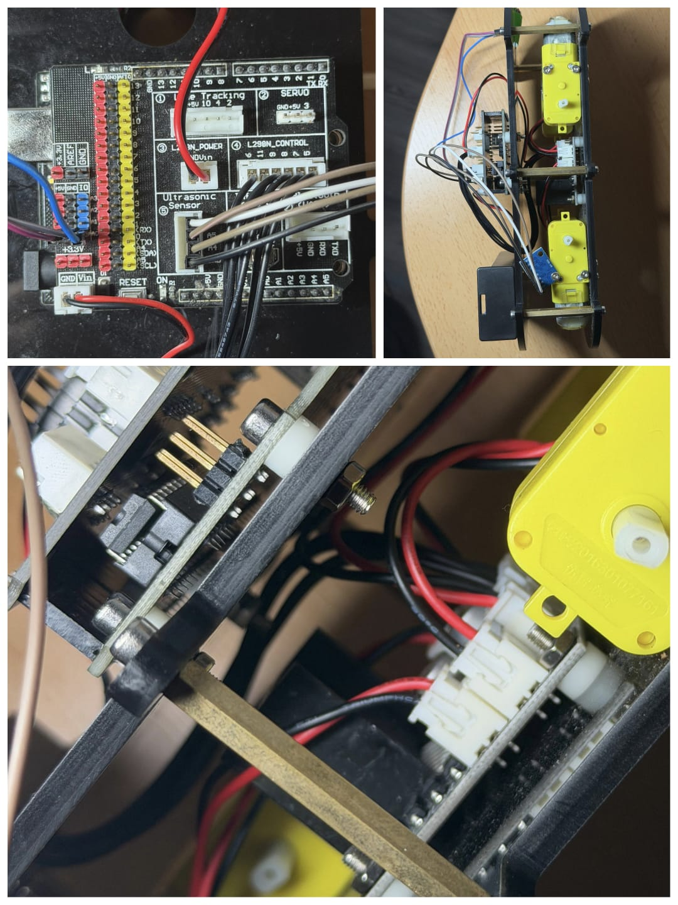
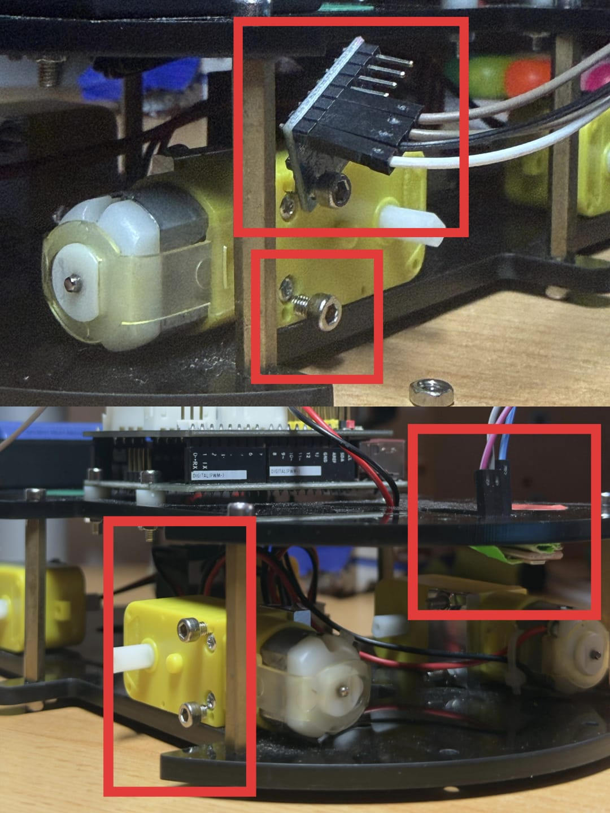
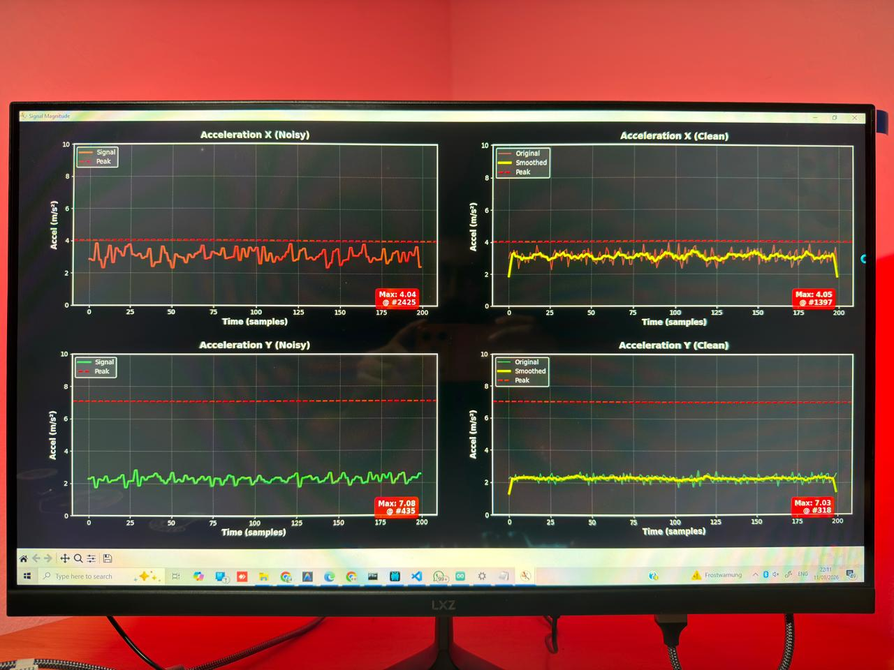
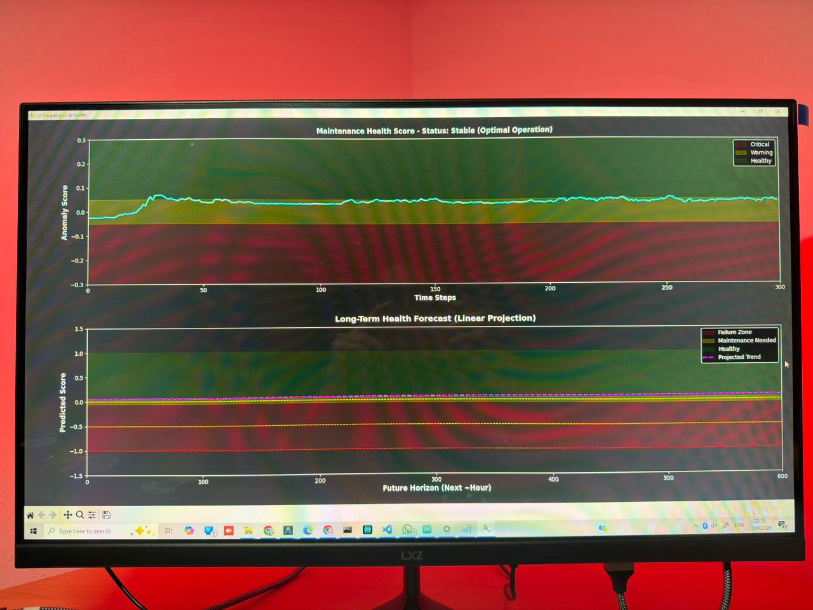

# Motor Condition Monitoring with Sensor Fusion

A small condition monitoring prototype for a DC motor test rig. An Arduino reads
an MPU6050 accelerometer and an analog microphone, and streams the readings over
USB serial to Python. The Python side does three things:

- classifies the motor state (healthy, faulty sound, faulty motor) with Random Forest and Gradient Boosting,
- gives a live anomaly score with an Isolation Forest trained on healthy data,
- forecasts a simulated degradation trend with ARIMA and estimates when the health index drops below 20 %.

Built for the course *Artificial Intelligence for Industrial Applications* at
OTH Amberg-Weiden (Winter 2025).









**Live simulation video:** https://drive.google.com/file/d/1UDYefiV69ZeJW5B6BnV9tufPQhvikkY9/view?usp=sharing

**Author:** Khushalkumar Variya. The project was built as a course project at OTH
Amberg-Weiden. An AI assistant helped with code cleanup, documentation and
the results tables; see [AI_USAGE.md](AI_USAGE.md).


## Hardware

- Arduino board with an MPU6050 accelerometer (I2C) and an analog microphone on A0
- L298N motor driver and two DC gear motors on a small chassis
- USB connection to the PC at 115200 baud

## Report

The full write-up is in [docs/REPORT.md](docs/REPORT.md). It contains corrections
where the original report differed from the code.

## Repository layout

```
docs/                            report text and photos
firmware/motor_data_collector/   Arduino sketch: motor control and sensor streaming
src/config.py                    paths, constants and the serial port setting
src/preprocess.py                outlier removal, unit conversion, FFT features
src/build_dataset.py             labels, combined file, 80/20 split
src/train_classifier.py          Random Forest vs Gradient Boosting on validation data
src/evaluate_holdout.py          final scoring on the 20 % hold-out set
src/train_anomaly_model.py       Isolation Forest and scaler on rolling-window features
src/forecast_health.py           ARIMA forecast on a simulated degradation trend
src/make_plots.py                signal and correlation plots
src/live_monitor.py              serial reader, live plots, anomaly status
figures/                         generated plots
```

## Pipeline

1. **Collect.** The firmware runs the motors at a fixed speed and sends 10,000
   readings per run at about 50 Hz. Each line is `sound,ax,ay`.
2. **Clean.** `preprocess.py` replaces values more than 3.5 standard deviations
   from the median with the median. It converts the accelerometer values to m/s²
   and computes the dominant frequency of the sound signal in 45-sample FFT windows.
3. **Label and split.** `build_dataset.py` labels the three recordings (0 healthy,
   1 faulty sound, 2 faulty motor) and makes a stratified 80/20 split.
4. **Classify.** `train_classifier.py` compares Random Forest and Gradient Boosting
   on a validation split of the training data. `evaluate_holdout.py` scores the
   chosen model on the hold-out set.
5. **Detect anomalies.** `train_anomaly_model.py` fits an Isolation Forest on
   rolling standard deviation and RMS features from the healthy recording.
6. **Monitor live.** `live_monitor.py` reads the serial port, logs the readings,
   and shows the signals and the anomaly score (Normal / Warning / Critical).
7. **Forecast.** `forecast_health.py` fits ARIMA(5,1,0) to a simulated degradation
   signal and reports the forecast error on the held-out days.

## Running it

```bash
pip install -r requirements.txt

python src/preprocess.py
python src/build_dataset.py
python src/train_classifier.py
python src/evaluate_holdout.py
python src/train_anomaly_model.py
python src/forecast_health.py
python src/make_plots.py

python src/live_monitor.py --simulate   # without hardware
python src/live_monitor.py              # with the Arduino (set SERIAL_PORT in src/config.py)
```

To flash the firmware, open `firmware/motor_data_collector/motor_data_collector.ino`
in the Arduino IDE and install the `MPU6050` library by Electronic Cats.

## Results

These are the numbers from the final report (`docs/REPORT.md`, section 9.2):

- Gradient Boosting on the 20 % hold-out set: **99.27 % accuracy**, weighted F1 about 0.99.
- Random Forest and Gradient Boosting were compared on a validation split. Gradient Boosting was chosen.

The numbers were not re-run for this repository. Running the full pipeline takes a long time,
so the scripts are included for anyone who wants to check them. A confusion matrix is written to
`figures/holdout_confusion_matrix.png` when `src/evaluate_holdout.py` runs.

**How to read the 99.27 %:** the hold-out split is random by row, and neighbouring rows come from
overlapping windows of the same recording. The score is probably too high. A split by recording
block would be a fairer test.

**Discrepancies between the report and the code** (the report is not changed; the code is what runs):

| Topic | Report says | Code does |
|---|---|---|
| Data split | 80 % train, 10 % test, 10 % validation | 80 % train, 20 % hold-out; validation is taken from the 80 % during model selection |
| Features | 7 features, including timestamp and label | 5 features: sound, ax, ay, frequency_hz, freq_magnitude |
| Accelerometer units | 1 g maps to about 9.81 m/s² | 1 g maps to about 4.0 m/s² (factor mismatch, see limitations) |
| Learning curve (Figure 10) | Learning curve over epochs | A terminal screenshot, not a learning curve |
| Health status | Regression slope ("Degrading" / "Improving") | Thresholds on the anomaly score (Normal / Warning / Critical) |
| Forecast | Remaining useful life of the motor | Time to a threshold on simulated drift |

## Limitations

The limitations below are in addition to the discrepancies above.

- **The hold-out split is random by row.** Neighbouring rows come from overlapping
  windows of the same recording, so the hold-out score is optimistic. The next
  step is to split by recording block.
- **Three recordings from one rig and one motor.** The results describe this setup only.
- **The forecast uses simulated drift.** The degradation is added to healthy data
  on purpose. It shows how the method works. It does not estimate the life of a real motor.
- **Units between firmware and Python need checking.** The MPU6050 gives 16384
  counts per g at the ±2 g range. The firmware divides by 200, so 1 g becomes about
  82. The Python side then multiplies by 9.81/200, so 1 g ends up at about 4.0 m/s²
  instead of 9.81. The values are consistent between training and live use, but
  the absolute m/s² numbers are too low by about a factor of 2.4 and should not be
  quoted as physical acceleration until this is fixed.
- **Faults were set up by hand** (a loose bolt, an unbalanced load, a dry-sounding
  bearing). They are not failures from long-term operation.

## Dependencies

See `requirements.txt`. Tested with Python 3.11.
